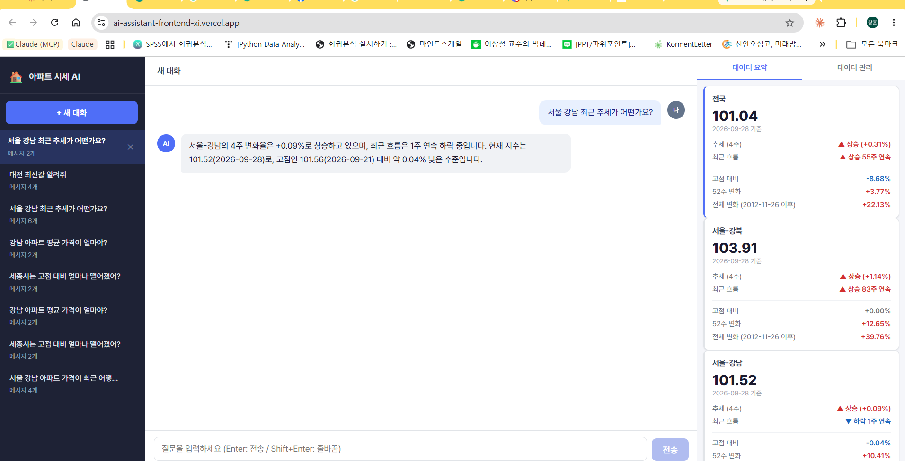
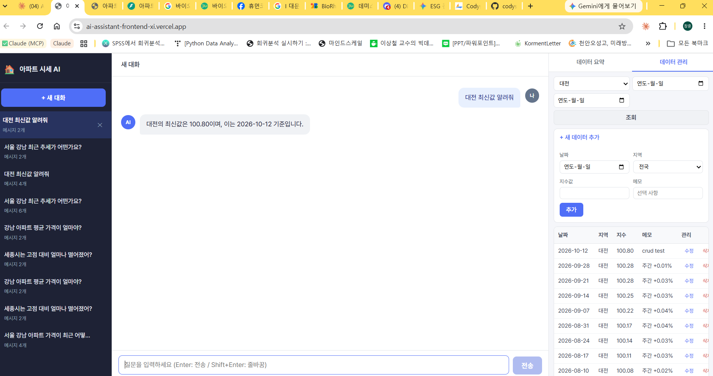
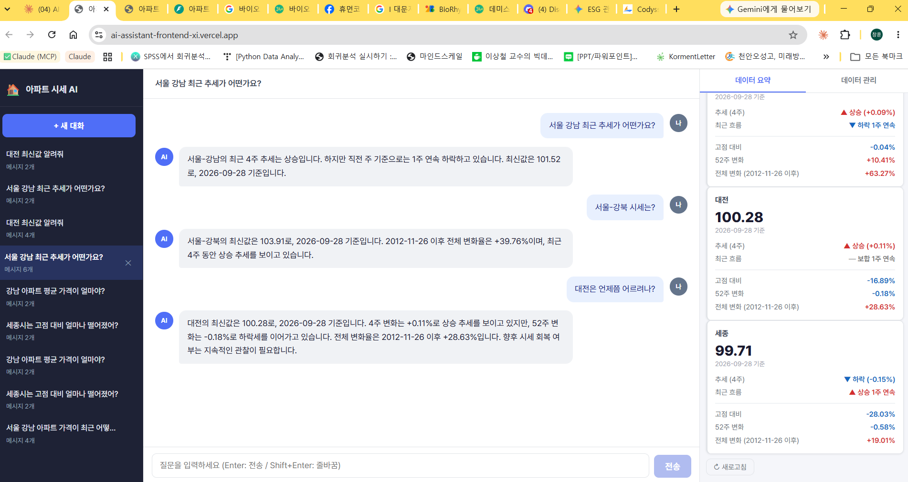

# 아파트 시세 AI 비서

한국부동산원 **주간 아파트 매매가격지수** 데이터(5개 지역, 2012-11-26 ~ 2026-09-28, 지역별 720주, 총 3,600건)를 기반으로 사용자 질문에 데이터 근거로 답하는 AI 웹서비스.
백엔드가 요약 통계를 계산해 GPT 시스템 프롬프트에 주입하고, GPT가 이를 근거로 자연어 답변을 생성합니다.

## 배포 URL

| 서비스 | URL |
|--------|-----|
| 프론트엔드 (Vercel) | https://ai-assistant-frontend-xi.vercel.app |
| API (Render) | https://ai-assistant-fenj.onrender.com |
| Swagger UI | https://ai-assistant-fenj.onrender.com/docs |

> **Render 무료 티어 콜드 스타트**: 비활성 상태에서 첫 요청 시 최대 1분이 소요될 수 있습니다. 화면에서 10초 후 안내 문구가 자동 표시됩니다.

---

## 스크린샷

### AI 채팅 — 요약 데이터 기반 답변

요약 카드의 수치와 AI 답변의 숫자가 일치합니다.

### 데이터 수정 → 요약 즉시 갱신

데이터 수정 후 요약 통계와 AI 답변이 즉시 반영됩니다.

### 이전 대화 불러오기

사이드바에서 이전 대화를 선택해 이어갈 수 있습니다.

---

## 기술 스택

| 분류 | 사용 기술 |
|------|-----------|
| 백엔드 | FastAPI · Python 3.12.9 · Uvicorn |
| 프론트엔드 | 바닐라 HTML / CSS / JavaScript |
| 데이터베이스 | Firebase Firestore (asia-northeast3) |
| AI | OpenAI gpt-4o-mini |
| 백엔드 배포 | Render (무료 티어) |
| 프론트엔드 배포 | Vercel |

---

## 데이터

- **출처**: 한국부동산원 R-ONE 전국주택가격동향조사 주간아파트동향
- **기간**: 2012-11-26 ~ 2026-09-28 (주간)
- **지역**: 전국 · 서울-강북 · 서울-강남 · 대전 · 세종 (5개 지역, 지역별 720주, 총 3,600건)
- **지수 기준시점**: 2026-07-06 = 100 (5개 지역 공통)

---

## 설계에서 신경 쓴 점

### AI 환각 방지
- 지역 순위(4주 추세·고점 대비·52주 변화)를 `_compute_rankings()`로 코드가 먼저 계산해 시스템 프롬프트에 주입합니다. GPT가 직접 수치를 비교하거나 계산하지 않고 주입된 값만 인용합니다.
- "이번 요청 시스템 프롬프트의 데이터만 사용, 이전 대화 숫자 재사용 금지" 규칙을 프롬프트에 명시합니다.
- '추세(4주 기준)'와 '최근 흐름(연속 주 수)'을 용어 수준에서 분리해 혼용을 막습니다.
- 매수·투자 질문 감지 시 리마인더를 삽입하고, 금지어(`매력적`, `유망`, `추천드립니다` 등)가 답변에 포함되면 1회 재생성합니다(INFO 로그).

### Firestore 읽기 최적화
- **지역별 메모리 캐시 (`row_cache`)**: 지역 첫 접근 시 Firestore를 읽고 이후는 메모리에서 반환합니다(지연 로딩). 스트리밍 도중 예외 시 캐시에 미대입(부분 로딩 방지).
- **기본 필터 `전국`**: 데이터 탭 최초 로드 시 전체 3,600건 조회 대신 720건만 접근합니다.
- **대화 목록 상한**: Firestore 쿼리 단에서 `order_by + limit(30)`으로 고정합니다.
- **결과**: 평가자 1인 시나리오 기준 약 31,000건 → 약 1,600건(서버 기동 직후) / 약 200건(캐시 적중), **95% 이상 절감**.

### 데이터 안전장치
- 프론트엔드(JS)·백엔드(Pydantic) 이중 입력 검증
- 날짜 월요일 검증: 주간 지수 날짜는 반드시 월요일이어야 합니다.
- 중복 날짜·지역 등록 시 409 안내
- 삭제 시 날짜·지역·값을 확인창에 명시
- Firestore 할당량 초과(ResourceExhausted) 시 HTTP 503 + 한국어 안내

### 자동 테스트
- `scripts/test_row_cache.py`: row_cache 동작 9가지 단위 테스트 (9/9 PASS)
- `scripts/test_chat_rules.py`: GPT 채팅 규칙 검증 (매수 질문·금지어·지수 해석 등)

---

## 로컬 개발

### 1. 저장소 클론

```bash
git clone https://github.com/chalee-victory/ai-assistant.git
cd ai-assistant
```

### 2. 백엔드 실행

```bash
cd backend
python -m venv venv
source venv/bin/activate   # Windows: venv\Scripts\activate
pip install -r requirements.txt
cp .env.example .env       # .env에 실제 키 입력
uvicorn main:app --reload
```

Swagger UI: `http://localhost:8000/docs`

### 3. 프론트엔드 실행

```bash
cd frontend
cp config.example.js config.js   # 기본값 localhost:8000
# 브라우저에서 index.html 열기 (Live Server 등)
```

---

## 환경변수

### 백엔드 (`.env` 또는 Render 환경변수)

| 변수명 | 용도 | 필수 |
|--------|------|------|
| `OPENAI_API_KEY` | OpenAI API 인증 키 | ✅ |
| `OPENAI_MODEL` | 사용할 GPT 모델 ID | ✅ |
| `FIREBASE_SERVICE_ACCOUNT_JSON` | Firebase 서비스 계정 키 (JSON 문자열) | ✅ |
| `FIREBASE_KEY_PATH` | 키 파일 경로 (로컬 개발 선택 사용) | — |
| `ALLOWED_ORIGINS` | CORS 허용 출처, 쉼표 구분 | ✅ |

### 프론트엔드 (Vercel 환경변수)

| 변수명 | 용도 | 필수 |
|--------|------|------|
| `API_BASE_URL` | 백엔드 Render 서비스 URL | ✅ |

---

## 배포 방법

### Render (백엔드)

1. Render 대시보드 → **New Web Service** → 이 저장소 연결
2. 설정:
   - **Root Directory**: `backend`
   - **Runtime**: Python 3
   - **Build Command**: `pip install -r requirements.txt`
   - **Start Command**: `uvicorn main:app --host 0.0.0.0 --port $PORT`
3. **Environment** 탭에서 위 환경변수 입력
4. Deploy → 서비스 URL 복사 (Vercel `API_BASE_URL`에 사용)

### Vercel (프론트엔드)

1. Vercel 대시보드 → **Add New Project** → 이 저장소 연결
2. 설정:
   - **Root Directory**: `frontend`
   - **Build Command**: `bash build.sh`
   - **Output Directory**: `.`
3. **Environment Variables** → `API_BASE_URL` = Render 서비스 URL
4. Deploy

### Firestore 초기 데이터 적재

```bash
cd backend
python scripts/seed_data.py      # CSV → Firestore 3,600건 업로드
python scripts/build_summary.py  # meta/summary 요약 계산·저장
```

---

## API 엔드포인트

| 메서드 | 경로 | 설명 |
|--------|------|------|
| `GET` | `/` | 헬스체크 |
| `POST` | `/api/data` | 데이터 추가 |
| `GET` | `/api/data` | 데이터 목록 조회 (지역·기간 필터, 페이지네이션) |
| `GET` | `/api/data/summary` | 요약 통계 조회 |
| `PUT` | `/api/data/{id}` | 데이터 수정 |
| `DELETE` | `/api/data/{id}` | 데이터 삭제 |
| `POST` | `/api/conversations` | 대화 생성 |
| `GET` | `/api/conversations` | 대화 목록 (최신순 30건) |
| `GET` | `/api/conversations/{id}` | 대화 상세 |
| `DELETE` | `/api/conversations/{id}` | 대화 삭제 |
| `POST` | `/api/chat` | AI 채팅 (GPT 호출, 대화 자동 저장) |

---

## 향후 개선 과제

- 관리자 인증 (현재는 누구나 데이터 CRUD 가능)
- 커서 기반 페이지네이션 (대용량 대비)
- 지역별 지수 추이 그래프
- CSV 내보내기
- 다크모드

---

## 폴더 구조

```
ai-assistant/
├── README.md
├── .gitattributes
├── backend/
│   ├── main.py              # FastAPI 앱, CORS, 라우터
│   ├── config.py            # 환경변수 로드
│   ├── firebase.py          # Firestore 클라이언트
│   ├── schemas.py           # Pydantic 스키마
│   ├── routers/             # data.py · conversations.py · chat.py
│   ├── services/            # data_service · summary_service · conversation_service · chat_service · row_cache
│   ├── scripts/             # seed_data · build_summary · show_prompt · test_row_cache · test_chat_rules · backfill_updated_at
│   ├── data/apt_price_index_weekly.csv
│   ├── requirements.txt
│   ├── .python-version      # 3.12.9
│   └── .env.example
├── frontend/
│   ├── index.html
│   ├── style.css
│   ├── app.js
│   ├── config.example.js
│   └── build.sh             # Vercel 빌드: API_BASE_URL → config.js
└── docs/
    └── screenshots/
        ├── 01-chat.png
        ├── 02-crud.png
        └── 03-history.png
```
