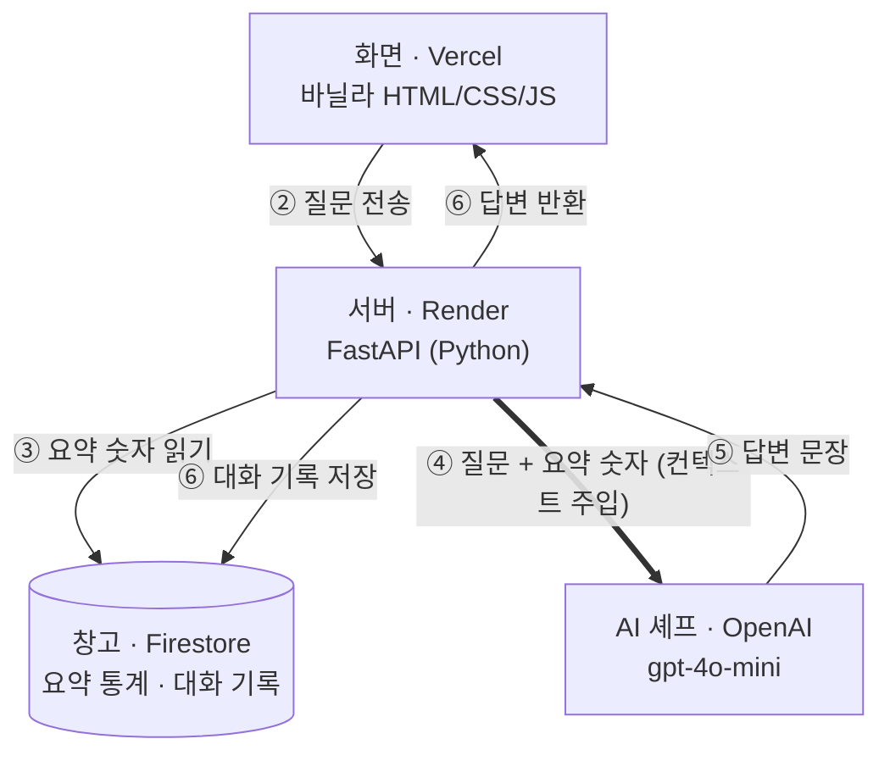

# 기술 스택과 배포 URL 쉽게 이해하기

> 아파트 시세 AI 비서를 처음 접하는 분을 위한 안내서입니다.
> 서비스를 **하나의 식당**에 비유해 각 기술의 역할을 설명합니다.

---

## 1. 들어가며: 식당으로 보면 한눈에 보인다

아파트 시세 AI 비서는 7가지 기술이 각자 한 가지 역할을 맡아 하나의 서비스를 이룹니다.
**기술 스택(Tech Stack)**은 서비스를 만드는 데 쓴 기술의 목록으로, 건물의 자재 목록과 같습니다.

| 기술 | 식당에서의 역할 | 한 줄 설명 |
| --- | --- | --- |
| 바닐라 HTML/CSS/JS | 홀 (손님이 보는 공간) | 사용자가 보고 클릭하는 화면 |
| FastAPI (Python) | 주방 | 요청을 받아 처리하는 서버 |
| Firebase Firestore | 창고 | 데이터를 보관하는 곳 |
| OpenAI gpt-4o-mini | 외부 전문 셰프 | 질문에 자연스러운 문장으로 답함 |
| Vercel | 홀 건물 임대 | 화면 파일을 인터넷에 올려 둠 |
| Render | 주방 건물 임대 | 서버를 24시간 켜 둠 |

---

## 2. 기술 스택 7가지

### ① Python 3.12.9 — 프로그래밍 언어

컴퓨터에게 일을 시키는 언어입니다. 문법이 영어 문장처럼 읽기 쉬워 AI와 데이터 분야에서 가장 많이 쓰입니다.

3.12.9는 버전 번호입니다. 같은 Python이라도 버전마다 조금씩 달라서, 내 PC와 Render 서버가 같은 버전을 쓰도록 고정했습니다(`backend/.python-version`).

### ② FastAPI — 서버를 만드는 도구

Python으로 API 서버를 빠르게 만들게 해 주는 프레임워크입니다.

- **API**: 프로그램끼리 주고받는 주문서 양식입니다. 화면이 "서울 강남 요약 주세요"라고 정해진 형식으로 요청하면, 서버가 정해진 형식으로 답합니다.
- **프레임워크**: 서버의 기본 골격을 미리 만들어 둔 조립식 자재입니다.

이 프로젝트에서 쓴 장점은 두 가지입니다.

- **입력 검증 자동화(Pydantic)**: 날짜를 빼먹거나 지수에 음수를 넣으면 자동으로 막습니다.
- **설명서 자동 생성(Swagger)**: 코드만 쓰면 사용 설명서 페이지가 저절로 만들어집니다.

### ③ Firebase Firestore (asia-northeast3) — 데이터베이스

구글이 운영하는 인터넷 데이터 창고입니다. `asia-northeast3`는 창고의 위치, 즉 **서울 데이터센터**입니다.

| 보관 위치 | 내용 |
| --- | --- |
| `data` | 아파트 매매가격지수 3,600건 (5개 지역 × 720주) |
| `conversations` | 사용자와 AI의 대화 기록 |
| `meta/summary` | 지역별 요약 통계 (미리 계산해 둔 것) |

표 형태가 아니라 문서(document)를 폴더(collection)에 넣는 방식이라 **NoSQL 데이터베이스**라고 부릅니다.

### ④ OpenAI gpt-4o-mini — AI 모델

ChatGPT를 만든 OpenAI의 AI 모델로, 사람 말을 이해하고 자연스러운 문장을 만듭니다. mini는 더 빠르고 저렴한 버전으로, 정해진 데이터를 설명하는 일에는 충분합니다.

핵심은 **AI에게 질문과 함께 참고자료를 준다**는 점입니다.

- GPT는 우리 데이터를 모르기 때문에, 그냥 물으면 그럴듯한 숫자를 지어낼 수 있습니다. 이것을 **환각**이라고 합니다.
- 그래서 서버는 질문을 보내기 전에 "서울-강남 최신값 101.52, 4주 +0.09%" 같은 요약 숫자를 함께 붙입니다. 이것을 **컨텍스트 주입**이라고 하며, 이 서비스의 핵심입니다.
- GPT는 그 숫자만 보고 문장으로 다듬습니다. 실제 테스트에서 AI 답변의 숫자가 요약 카드와 정확히 일치했습니다.

### ⑤ 바닐라 HTML/CSS/JS — 화면

사용자가 브라우저에서 보는 화면을 만드는 세 가지 기술입니다.

| 기술 | 역할 | 비유 |
| --- | --- | --- |
| HTML | 화면의 구조 (제목, 버튼, 입력칸) | 집의 뼈대 |
| CSS | 디자인 (색, 글꼴, 배치) | 인테리어 |
| JavaScript | 동작 (버튼을 누르면 전송, 결과 표시) | 전기와 수도 |

**바닐라**는 아무것도 첨가하지 않은 기본 맛이라는 뜻입니다. React 같은 화면 제작 프레임워크 없이 기본 기술만으로 만들었다는 의미입니다.

### ⑥ Render — 백엔드 호스팅

FastAPI 서버를 24시간 켜 두는 인터넷 위의 컴퓨터를 빌려주는 서비스입니다. 내 PC에서 `uvicorn`으로 켜던 서버를 대신 실행합니다.

무료 요금제는 15분 동안 요청이 없으면 서버를 재웁니다. 다음 요청 때 깨어나는 데 최대 1분이 걸리며, 이를 **콜드스타트**라고 합니다. 그래서 화면에 "서버를 깨우는 중입니다" 안내를 넣었습니다.

### ⑦ Vercel — 프론트엔드 호스팅

HTML·CSS·JS 화면 파일을 인터넷에 올려 두는 서비스입니다. 화면 파일은 계산 없이 나눠 주기만 하면 되므로, 빠른 전달에 특화된 Vercel이 잘 맞습니다.

Render와 Vercel 모두 GitHub에 코드를 올리면(push) **자동으로 새 버전을 반영**합니다.

---

## 3. 배포 URL 3종

**배포(Deploy)**는 내 PC에서만 돌던 프로그램을 인터넷에 올려 누구나 쓸 수 있게 하는 것이고, **URL**은 그 인터넷 주소입니다. 세 주소는 쓰는 사람과 보이는 것이 다릅니다.

| 구분 | 주소 | 누가 쓰나 | 무엇이 보이나 | 식당 비유 |
| --- | --- | --- | --- | --- |
| 프론트엔드 | [ai-assistant-frontend-xi.vercel.app](https://ai-assistant-frontend-xi.vercel.app) | 사용자, 평가자 | 채팅 화면, 요약 카드, 데이터 관리 표 | 식당 정문 |
| API | [ai-assistant-fenj.onrender.com](https://ai-assistant-fenj.onrender.com) | 사람이 아니라 프론트엔드 화면(프로그램) | 서비스 상태를 알리는 기계용 글자 | 주방 쪽문 |
| Swagger | [ai-assistant-fenj.onrender.com/docs](https://ai-assistant-fenj.onrender.com/docs) | 개발자, 평가자 | 기능 목록과 설명, 직접 실행 버튼 | 메뉴 설명서 겸 시식 코너 |

### 프론트엔드: 사용자가 여는 주소

손님이 들어오는 정문입니다. 주소 끝의 `-xi`는 같은 이름을 다른 사람이 이미 쓰고 있어서 Vercel이 자동으로 붙인 구분 글자입니다.

### API: 서버의 주소

홀 직원(화면)이 주문서를 들고 드나드는 주방 쪽문입니다. 사용자가 채팅을 보내면 화면이 이 주소로 `POST /api/chat` 요청을 보내고, 서버가 답을 돌려줍니다.

직접 열면 다음과 같은 글자가 보입니다. 사용자는 이 주소를 몰라도 서비스를 쓸 수 있습니다.

```json
{"service": "아파트 시세 AI 비서 API", "docs": "/docs", "status": "ok"}
```

### Swagger: API 설명서 겸 시험장

FastAPI가 코드를 보고 자동으로 만든 페이지입니다. 각 기능의 **Try it out → Execute** 버튼으로 화면을 거치지 않고 서버에 직접 요청해 볼 수 있습니다. 평가자는 여기서 데이터 조회와 입력 검증이 제대로 되는지 바로 확인할 수 있습니다.

---

## 4. 전체 흐름: 질문 하나가 처리되는 7단계



| 단계 | 하는 일 | 쓰인 기술 |
| --- | --- | --- |
| ① | 사용자가 화면에서 질문 입력 | HTML/CSS/JS + Vercel |
| ② | 화면이 서버로 질문 전송 | JavaScript → FastAPI |
| ③ | 서버가 창고에서 요약 숫자를 꺼냄 | FastAPI + Firestore |
| ④ | 서버가 질문과 요약 숫자를 함께 AI에 보냄 (**컨텍스트 주입**) | FastAPI + OpenAI |
| ⑤ | AI가 숫자를 근거로 답변 문장을 만듦 | gpt-4o-mini |
| ⑥ | 서버가 대화를 저장하고 답변을 화면으로 보냄 | FastAPI + Firestore |
| ⑦ | 화면에 AI 말풍선으로 표시 | JavaScript |

핵심은 **④번**입니다. 서버가 Firestore에서 꺼낸 요약 숫자를 질문에 붙여 GPT에 보내기 때문에, AI 답변의 숫자가 실제 데이터와 일치합니다.

---

## 5. 핵심 용어

| 용어 | 뜻 |
| --- | --- |
| 기술 스택 | 서비스를 만드는 데 쓴 기술의 목록 |
| 프론트엔드 | 사용자가 보는 화면 쪽 |
| 백엔드 | 화면 뒤에서 요청을 처리하는 서버 쪽 |
| API | 프로그램끼리 주고받는 요청과 응답의 약속된 형식 |
| 프레임워크 | 기본 골격을 미리 만들어 둔 개발 도구 |
| 데이터베이스 | 데이터를 보관하고 꺼내 쓰는 저장소 |
| 환각 | AI가 근거 없이 그럴듯한 내용을 지어내는 현상 |
| 컨텍스트 주입 | AI에게 질문과 함께 근거 자료를 넣어 주는 방식 |
| 배포 | 프로그램을 인터넷에 올려 누구나 쓰게 하는 것 |
| 호스팅 | 프로그램이나 파일을 인터넷 서버에 올려 두는 서비스 |
| 콜드스타트 | 잠든 무료 서버가 첫 요청에 깨어나느라 늦게 응답하는 현상 |
| push | 내 PC의 코드 변경을 GitHub에 올리는 것 |

---

[← README로 돌아가기](../README.md)
